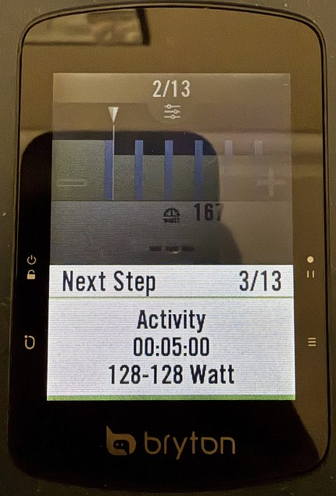
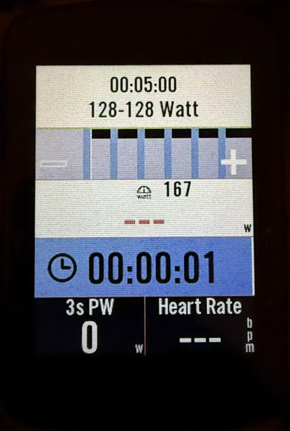
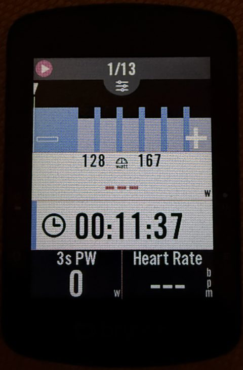
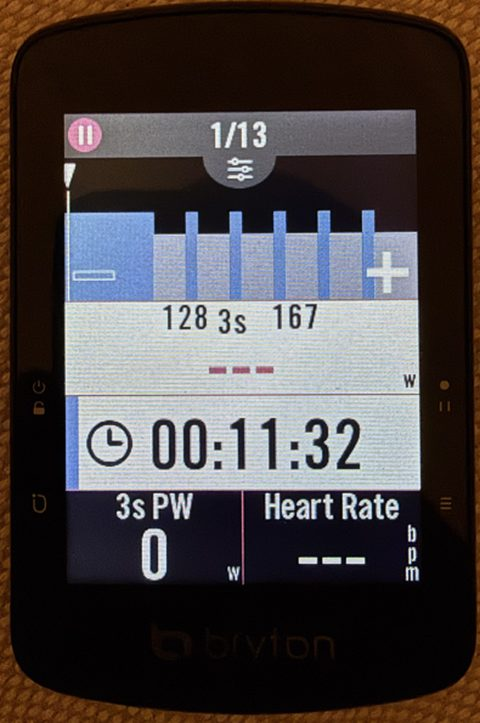
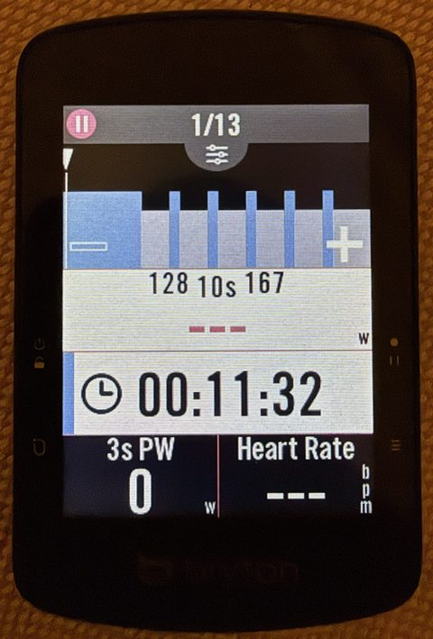
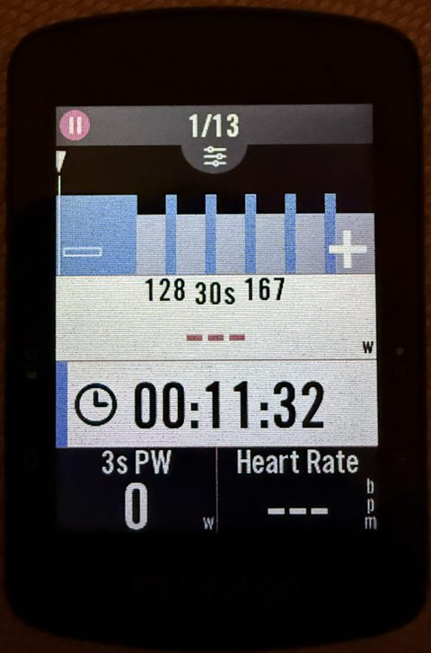

# Rider S510 mods

Unofficial firmware improvements for the **Bryton Rider S510** GPS bike computer, mostly for structured
workouts. You build them **in your browser** from Bryton's own firmware, copy two files to the unit, done.

**→ [Open the web builder](https://taladjidi.github.io/bryton-S510-mods/)**

| Stock next-step popup | Patched: strip | Tap: instant | 3 s | 10 s | 30 s |
|:---:|:---:|:---:|:---:|:---:|:---:|
|  |  |  |  |  |  |

## What it changes

| Change | Patch |
|--------|-------|
| **3 countdown beeps** (3-2-1) before a workout step ends, instead of ~9 | `P1` |
| The full-screen "next step" popup becomes a **small strip over the chart** (next duration + target), without dimming the screen | `P3` |
| Fix: that strip always hides when the step changes (even on 15 s intervals) | `P4` |
| **Tap the big power number** on a power step to switch between instant, 3 s, 10 s and 30 s average power. The box shows `3s` / `10s` / `30s`; the choice is kept across restarts. | `P5` |

All four together are the **workout** set — the default in the web builder. Your settings, rides and workouts
are kept.

> [!WARNING]
> **Not affiliated with or endorsed by Bryton.** Use at your own risk; it may void your warranty. Tested on
> **one** unit, firmware **R039**. See [Is it safe?](#is-it-safe) below.

## Try it

1. Plug the S510 into a computer. On its **BRYTON** drive, `System/device.txt` must say `Version=R039` under
   `[OS]`. Battery **≥ 38 %** (below that the unit silently skips updates).
2. Open the [web builder](https://taladjidi.github.io/bryton-S510-mods/), keep or change the selection, click
   **Build my firmware**. Your browser downloads the official firmware from Bryton's server, checks it, and
   applies the changes — nothing is uploaded anywhere.
3. Save `IMG.bin` and `update.ini` to the top level of the BRYTON drive (Chrome/Edge can write them directly).
4. Eject the drive and unplug. The unit restarts, shows an update animation for about a minute, restarts again.

**Back to stock:** same steps with **Back to stock firmware** — that installs Bryton's original file, unchanged.

## Bryton updates

Patched firmware still reports version R039, so the Bryton app behaves as before and only offers an update
when Bryton publishes a new version. Accepting it installs Bryton's firmware (the changes are gone until they
are adapted to the new version); declining keeps your patched R039. The patches can't be applied to the wrong
firmware: the builder refuses anything that isn't exactly R039. A
[scheduled check](.github/workflows/watch-bryton-firmware.yml) opens an issue here when Bryton releases a new
version — watch the repository to be told.

## Is it safe?

- The **bootloader** (the part that starts the firmware) is never modified. It has its own USB recovery mode
  that can rewrite the stock firmware even when a patched one doesn't start — proven on the test unit.
  How: [docs/recovery.md](docs/recovery.md) (needs a Mac or Linux computer with Python).
- Every build re-checks everything the unit checks before it accepts an update, and patches can only change
  the bytes they declare. See [Checks behind this](#checks-behind-this) and [docs/validation.md](docs/validation.md).
- The bike computer itself does no signature check: like stock firmware, it installs whatever is placed on its
  drive. Only use builds you made yourself from this page or these scripts.

## Command line (for tinkerers)

Python ≥ 3.8 on macOS, Linux or Windows; `tqdm` is optional (progress bars).

```sh
git clone https://github.com/taladjidi/bryton-S510-mods && cd bryton-S510-mods
python3 tools/fetch_firmware.py      # stock R039 from Bryton's server, must print "OK (stock R039)" twice
python3 deploy.py workout            # build + copy to the BRYTON drive + verify (macOS also ejects)
python3 deploy.py vanilla            # back to stock
python3 deploy.py -n mine P1 P5      # your own selection; build.py alone builds without copying
```

Tests (offline, need the stock firmware): `python3 tests/test_tools.py`. GitHub Actions runs them on every push.

Every build starts from stock: installing `P1 P5` removes anything else you had. `deploy.py` keeps a local
`FLASHLOG.md` of what you installed.

| Developer patch | What it does |
|-----------------|--------------|
| `T1` | Renames the data-field title "3s PW" to "3s QW": a harmless visible change, used to prove the build → install path |
| `D1` | Saves the firmware's debug log to `\Debug` at every start |

| Tool | What it does |
|------|--------------|
| `site/` | The web builder (`builder.js` is a port of `build.py`; `test.mjs` checks they agree) |
| `tools/fetch_firmware.py` | Downloads stock firmware from Bryton and checks it is exactly R039 (or takes your unit's readback) |
| `build.py` / `deploy.py` | Apply patches and build `IMG.bin` + `update.ini` / also copy them to the unit |
| `tools/iaprecover.py` | Recovery through the bootloader: read back, or rewrite with stock ([docs/recovery.md](docs/recovery.md)) |
| `tools/ewstr.py` | Decoder/encoder for the firmware's compressed text blocks |
| `ghidra/` | Ghidra scripts used for the analysis — not needed to use the patches |

How the unit updates, boots and stores its UI, and what each patch changes: [docs/how-it-works.md](docs/how-it-works.md).

## Checks behind this

Short version of [docs/validation.md](docs/validation.md):

- The tools reproduce **every check the unit makes** on an update (image checksum, gzip, padding, package
  checksum, size limits) and re-verify the built package by decompressing it again.
- Going back to stock installs Bryton's original `img.bin` unchanged. Patched builds differ from stock **only**
  in the declared bytes (plus the 4-byte checksum), which `build.py` checks.
- The web builder runs the same checks and must produce exactly the same firmware as `build.py` (checked on
  every push by GitHub Actions, together with building every patch).
- Patches identify what they replace by **hash**, not by copying it: a wrong firmware, wrong address, two
  overlapping patches or a patch applied twice are refused.
- The text-block encoder reproduces Bryton's compressed blocks **byte for byte** before it is trusted to write one.
- On the unit: full readback == stock, full stock rewrite + readback == stock and boots, then every patch flashed
  and used on real workouts (details in validation.md).

## Writing patches

```
title:  short name shown in the web builder
desc:   one line
source: where the change is explained
0xADDR  sha256:<first 16 hex of sha256(original bytes)>  <new bytes, hex>
string  0xBLOCK  0xINDEX  sha256:<16 hex of the original text>  room=<bytes>  "new text"
```

Addresses are load addresses (the image runs at `0xd0000000`). See [docs/how-it-works.md](docs/how-it-works.md)
for the image layout and the string blocks, and `build.py`'s header for the details. Patches with new code
(`P5`) keep the assembly next to the `.patch` file; it is assembled with
`clang --target=thumbv7em-none-eabi -mcpu=cortex-m7 -c`, and every instruction is checked in Ghidra with
`ghidra/scripts/PatchCheck.java` before flashing.

## Legal

The firmware is Bryton's copyrighted work and is **not** included here — not as a file, and not as fragments
inside patches (they carry only new bytes and hashes). This repo contains my own code and documentation of how
the device works, written for interoperability and to let owners fix things on hardware they own. Bryton names
are used only to say what this is compatible with. If you represent Bryton and have a concern, please open an
issue or contact me — I'd much rather talk than have it taken down.

Code: [MIT](LICENSE).
