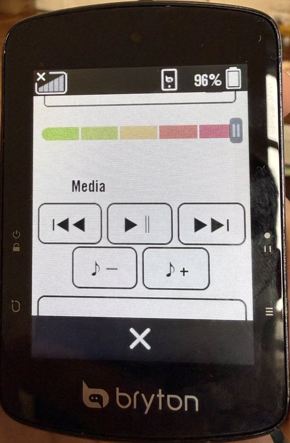
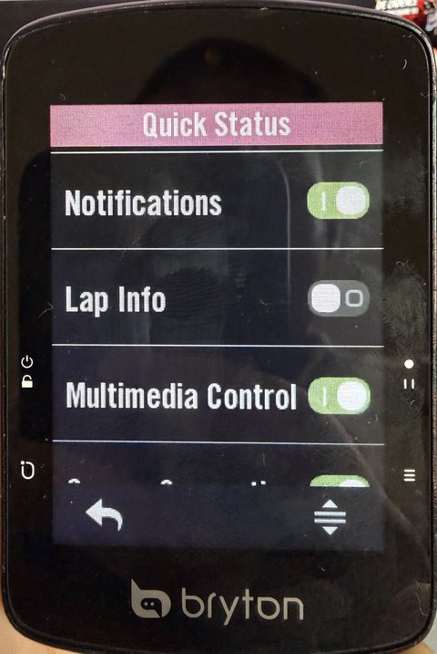

# Rider S510 mods

Unofficial firmware improvements for the **Bryton Rider S510** GPS bike computer: **media buttons for your
phone** right on the unit, and a better structured-workout screen. You build them **in your browser** from
Bryton's own firmware, copy two files to the unit, done.

**→ [Open the web builder](https://taladjidi.github.io/bryton-S510-mods/)**

| Media buttons for your phone | Switched on in Quick Status |
|:---:|:---:|
|  |  |

| Stock next-step popup | Patched: strip | Tap: instant | 3 s | 10 s | 30 s |
|:---:|:---:|:---:|:---:|:---:|:---:|
|  |  |  |  |  |  |

## What it changes

| Change | Patch |
|--------|-------|
| **3 countdown beeps** (3-2-1) before a workout step ends, instead of ~9 | `P1` |
| The full-screen "next step" popup becomes a **small strip over the chart** (next duration + target), without dimming the screen; it always hides when the step changes, even on 15 s intervals | `P3` |
| **Tap the big power number** on a power step to switch between instant, 3 s, 10 s and 30 s average power. The box shows `3s` / `10s` / `30s`; the choice is kept across restarts. | `P5` |
| Fix: the 3 s / 10 s / 30 s power fields also move before the ride starts (they stayed frozen until a GPS fix). | `P6` |
| **Media buttons for your phone** in the overview (the panel a tap on the ride screen opens): previous, play/pause, next, volume down/up, for whatever app is playing. Turn on **Multimedia Control** in Quick Status. **Re-pair once after installing** (see below). **Only tested with an iPhone so far.** | `P7` |
| **HRV recording:** beat-to-beat heart rate (RR intervals) from ANT+ or Bluetooth straps is saved in the ride file, so Intervals.icu, Runalyze or Kubios can show HRV and DFA a1 afterwards. Nothing changes on screen. **Tested on a 97 min ride (ANT+ strap): 96% of beats recorded, about 3% artifacts. Intervals.icu keeps the beats (Ride CSV) but does not chart DFA a1 from them on its own.** | `P8` |
| **Live DFA a1 field** (aerobic threshold from heart rate variability: about 0.75 at the threshold, above 1 when easy), from the beats of the last 2 minutes. Needs `P8` and a strap that sends beat times. Pick it on the unit with `P11` (Heart Rate category, last item), or with `GridN=12` in `System/Bike1Profile.ini`. The value is also saved in the ride file every second as `Alpha1`, the field Intervals.icu charts (as from the AlphaHRV app on Garmin units). **Not yet tested on a unit.** | `P9` |
| **DFA a1 in the field menu:** pick the live DFA a1 field on the unit (Heart Rate category, last item), on the ride screen or in Settings, instead of editing `Bike1Profile.ini`. Take it with `P9`. Tested on the unit (both menus). | `P11` |
| **Shimano Di2 hood buttons** get 10 actions instead of 4 copies of the unit's buttons: Lap, Start/Stop, Lock/Unlock, Next Page, Previous Page, Quick Status, Map, First Data Page, Home Page, Latest Notification. With `P7`, also **Play/Pause, Next Track, Previous Track, Volume + / -** for the phone. Set them on the Di2 sensor's page: Sensor Details > Remote Setup ([pictures](docs/how-it-works.md#di2-hood-buttons-p12)). Tested on the unit. | `P12` |
| **Snappier screen:** the firmware's debug messages no longer wait for an internal serial port nobody reads (about 1.2 kB of them per page change, ~87 µs per character). Tested on the unit. | `P13` |
| **The page button changes page at once:** stock, it first plays its click (50 ms pause + 80 ms beep) and only then asks for the next page, 130 to 290 ms later depending on how busy the unit is. Now the page changes first and the click plays during the redraw (key to page change: 0 to 1 ms in the debug log). Tested on the unit. | `P14` |

`P1` `P3` `P5` `P6` `P7` together are the **recommended** set, the default in the web builder.

> [!TIP]
> **Fueling reminders by energy need no patch.** In Settings > bike > Reminders, set *Reminder by* to Total Work
> (kJ, needs a power meter) or Calories, frequency *Repeats*, type *Eat* or *Drink*: the unit alerts every N kJ or
> calories while recording.

> [!IMPORTANT]
> **`P7` needs the phone to be paired again once.** After installing, on the phone open the Bluetooth settings,
> forget the S510 ("Forget This Device" on an iPhone), then pair it again from the Bryton app. Until then the
> buttons do nothing (the phone keeps its old list of the S510's services). Only tested with an **iPhone** so
> far; if you try it on Android, please send a test report. Your settings, rides and workouts
are kept.

> [!WARNING]
> **Not affiliated with or endorsed by Bryton.** Use at your own risk; it may void your warranty. Tested on
> **one** unit, firmware **R039**. See [Is it safe?](#is-it-safe) below.

## Try it

1. Plug the S510 into a computer. On its **BRYTON** drive, `System/device.txt` must say `Version=R039` under
   `[OS]`. Battery **≥ 38 %** (below that the unit silently skips updates).
2. Open the [web builder](https://taladjidi.github.io/bryton-S510-mods/), keep or change the selection, click
   **Build my firmware**. Your browser downloads the official firmware from Bryton's server, checks it, and
   applies the changes. Nothing is uploaded anywhere.
3. Save `IMG.bin` and `update.ini` to the top level of the BRYTON drive (Chrome/Edge can write them directly).
   They go next to the folders, not inside one:
   ```
   BRYTON/
   ├── Activities/
   ├── System/
   ├── Workout/
   ├── …            (other folders: leave them alone)
   ├── IMG.bin      ← copy here
   └── update.ini   ← copy here
   ```
4. Eject the drive and unplug. The unit restarts, shows an update animation for about a minute, restarts again.

**Back to stock:** same steps with **Back to stock firmware**, which installs Bryton's original file, unchanged.

## Bryton updates

Patched firmware still reports version R039, so the Bryton app behaves as before and only offers an update
when Bryton publishes a new version. Accepting it installs Bryton's firmware (the changes are gone until they
are adapted to the new version); declining keeps your patched R039. The patches can't be applied to the wrong
firmware: the builder refuses anything that isn't exactly R039. A
[scheduled check](.github/workflows/watch-bryton-firmware.yml) opens an issue here when Bryton releases a new
version: watch the repository to be told.

## Is it safe?

- The **bootloader** (the part that starts the firmware) is never modified. It has its own USB recovery mode
  that can rewrite the stock firmware even when a patched one doesn't start (proven on the test unit).
  How: [docs/recovery.md](docs/recovery.md) (needs a Mac or Linux computer with Python).
- Every build re-checks everything the unit checks before it accepts an update, and patches can only change
  the bytes they declare. See [Checks behind this](#checks-behind-this) and [docs/validation.md](docs/validation.md).

> [!CAUTION]
> 🔓 **Zero cryptographic checks, anywhere.** 🚫🔐 No signature, no encryption, no secure hash: not in the
> bootloader, not in the firmware's update code, not in the Bryton app. The only checks are an additive checksum
> and the gzip CRC32, which catch a corrupted file but not a deliberately modified one (anyone can recompute them,
> as `build.py` does). **The S510 will install whatever firmware it is given.** 🤷
>
> - 📦 **This is how the S510 ships, not something these patches introduce or change.** A stock unit installs any
>   `IMG.bin` + `update.ini` placed on its drive at the next start, just like a patched one.
> - 💻 Anything with access to the drive while it is plugged in can do the same: the computer it is connected to
>   and any program running on it. Only connect the unit to computers you trust.
> - 🛠️ The bootloader's recovery mode needs the unit in hand (4-button reboot) and checks nothing either.
> - ✅ Only install builds you made yourself, with this page or these scripts, from Bryton's own firmware.

## Command line (for tinkerers)

Python ≥ 3.8 on macOS, Linux or Windows; `tqdm` is optional (progress bars).

```sh
git clone https://github.com/taladjidi/bryton-S510-mods && cd bryton-S510-mods
python3 tools/fetch_firmware.py      # stock R039 from Bryton's server, must print "OK (stock R039)" twice
python3 deploy.py recommended        # build + copy to the BRYTON drive + verify (macOS also ejects)
python3 deploy.py vanilla            # back to stock
python3 deploy.py -n mine P1 P5      # your own selection; build.py alone builds without copying
```

Tests (offline, need the stock firmware): `python3 tests/test_tools.py`. GitHub Actions runs them on every push.

Every build starts from stock: installing `P1 P5` removes anything else you had. `deploy.py` keeps a local
`FLASHLOG.md` of what you installed.

| Developer patch | What it does |
|-----------------|--------------|
| `T1` | Renames the data-field title "3s PW" to "3s QW": a harmless visible change, used to prove the build → install path |
| `D1` | Saves the firmware's debug log to `\Debug` at every start |

| Tool | What it does |
|------|--------------|
| `site/` | The web builder (`builder.js` is a port of `build.py`; `test.mjs` checks they agree) |
| `tools/fetch_firmware.py` | Downloads stock firmware from Bryton and checks it is exactly R039 (or takes your unit's readback) |
| `build.py` / `deploy.py` | Apply patches and build `IMG.bin` + `update.ini` / also copy them to the unit |
| `tools/iaprecover.py` | Recovery through the bootloader: read back, or rewrite with stock ([docs/recovery.md](docs/recovery.md)) |
| `tools/asm2patch.py` | Assembles a code patch (`patches/*.s`) with clang and prints its `.patch` lines |
| `tools/ewstr.py` | Decoder/encoder for the firmware's compressed text blocks |
| `ghidra/` | Ghidra scripts used for the analysis, not needed to use the patches |

How the unit updates, boots and stores its UI, and what each patch changes: [docs/how-it-works.md](docs/how-it-works.md).

## Checks behind this

Short version of [docs/validation.md](docs/validation.md):

- The tools reproduce **every check the unit makes** on an update (image checksum, gzip, padding, package
  checksum, size limits) and re-verify the built package by decompressing it again.
- Going back to stock installs Bryton's original `img.bin` unchanged. Patched builds differ from stock **only**
  in the declared bytes (plus the 4-byte checksum), which `build.py` checks.
- The web builder runs the same checks and must produce exactly the same firmware as `build.py` (checked on
  every push by GitHub Actions, together with building every patch).
- Patches identify what they replace by **hash**, not by copying it: a wrong firmware, wrong address, two
  overlapping patches or a patch applied twice are refused.
- The text-block encoder reproduces Bryton's compressed blocks **byte for byte** before it is trusted to write one.
- On the unit: full readback == stock, full stock rewrite + readback == stock and boots, then every patch flashed
  and used on real workouts (details in validation.md).

## Writing patches

```
title:  short name shown in the web builder
desc:   one line
source: where the change is explained
0xADDR  sha256:<first 16 hex of sha256(original bytes)>  <new bytes, hex>
string  0xBLOCK  0xINDEX  sha256:<16 hex of the original text>  room=<bytes>  "new text"
```

Addresses are load addresses (the image runs at `0xd0000000`). See [docs/how-it-works.md](docs/how-it-works.md)
for the image layout and the string blocks, and `build.py`'s header for the details. Patches with new code
keep their source next to the `.patch` file, in assembly (`P5`, `P6`) or C (`P7`):
`python3 tools/asm2patch.py patches/P7-*.c` builds it with clang, links it at the cave address and prints the
patch lines (the code, the `bl` hooks declared with `@hook` and the `b.w` ones declared with `@jump`). Every instruction
is checked in Ghidra with `ghidra/scripts/PatchCheck.java` before flashing.

## Contributing

Feedback is very welcome, especially from other S510 owners.

- **Tried it?** Fill in a [test report](https://github.com/taladjidi/bryton-S510-mods/issues/new?template=test-report.yml),
  good or bad: which patches, how you installed them (web builder or scripts, which OS) and what you saw on the
  unit. Reports from units other than the test unit are the most useful thing right now.
- **Something you would change on the S510?** Open an [idea](https://github.com/taladjidi/bryton-S510-mods/issues/new?template=idea.yml). Workout and data-screen behaviour is
  the best understood part of the firmware so far.
- **Pull requests** are welcome: new patches (format in [Writing patches](#writing-patches); explain the change
  in `docs/how-it-works.md` and keep Bryton's bytes out of the patch), fixes to the tools, the web builder or the
  docs. `python3 tests/test_tools.py` must pass; GitHub Actions runs it on every PR.
- Owners of other recent Bryton units: an issue saying which model and firmware version you have is a good start.

## Legal

The firmware is Bryton's copyrighted work and is **not** included here: not as a file, and not as fragments
inside patches (they carry only new bytes and hashes). This repo contains my own code and documentation of how
the device works, written for interoperability and to let owners fix things on hardware they own. Bryton names
are used only to say what this is compatible with. If you represent Bryton and have a concern, please open an
issue or contact me. I'd much rather talk than have it taken down.

Code: [MIT](LICENSE).
