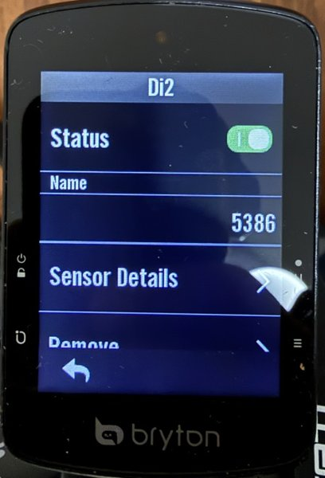
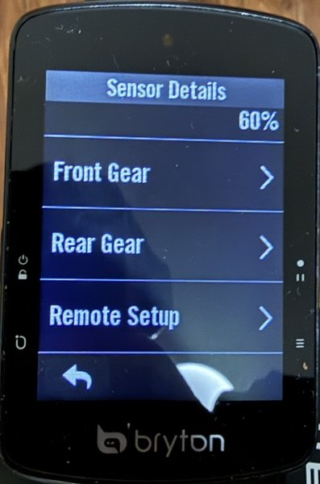
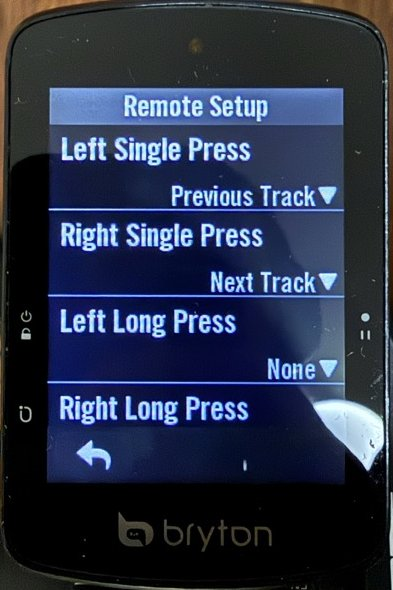

# How the Rider S510 firmware works (R039 / bootloader R002)

Notes from reverse-engineering, written as plain descriptions. Addresses are where things live in the firmware
image as loaded on the unit (main image at `0xd0000000`, bootloader at `0x08000000`); open the image in Ghidra
with the same base to follow along (see [../ghidra/README.md](../ghidra/README.md)).

## Hardware and software stack

- MCU: STM32H747 (Cortex-M7). The main firmware runs from external SDRAM at `0xd0000000`.
- Storage: ~31 GB eMMC. One region holds the firmware image; the rest is the FAT volume you see over USB.
- GNSS u-blox, Bluetooth via a Nordic chip, ANT+.
- RTOS: µC/OS-II (kernel copied to the M7's ITCM at boot). Filesystem: Micrium µC/FS. UI: Embedded Wizard 11.
  Compiler: IAR EWARM 8.30.
- Nothing is encrypted or signed. Integrity checks are a plain additive checksum, gzip's CRC32, and a read-back
  after writing.
- Learned from the from-scratch firmware (bryton-rustfw, 2026-10-23, read on the unit over its USB link):
  - The power button drives two pins: PA0 goes high (the standby wake-up pin WKUP1) and PA1 goes low (the key).
    PA0 must be a GPIO input before standby, as stock sets it: left in its reset analog mode, the press does not
    wake the unit, and only the four-button restart brings it back.
  - The panel's SPI1 (software chip select): CR1.SSI must be set before CFG2.MASTER, otherwise a mode fault
    clears MASTER and the SPI never clocks.
  - The Nordic BLE / ANT chip: USART2 at 1 Mbaud with RTS / CTS, framed as a 2-byte little-endian length then
    the payload (no SLIP: that is only its DFU bootloader). Reset on PA6; PI4 high selects its application (low
    through a reset, the DFU bootloader, inferred). Stock waits 800 ms after the reset, then speaks first. On the
    unit `sd_ble_enable` succeeds and `sd_ble_version_get` returns 4 / 1 / 50, which stock logs as the Nordic
    image, bootloader and SD versions (the image number is in RTC backup register 12).
    Stock's SoftDevice API is v5: `sd_ble_gap_scan_start` is op 0x8a (flags, interval, window, timeout), scan
    reports are event 0x1d with the data inline, and power off is `sd_power_system_off` (op 0x32, no reply).
    ANT commands are type 6 but their responses come back as type 1, like BLE ones (seen on the unit). Stock's
    heart-rate channel (enable, network key on net 0, assign, channel id type 0x78, search timeout 0xff, 2457 MHz,
    period 8070, open on channel 0) opens with every command answered 0. The ANT+ network key is licensed: stock
    loads it from its initialised data (0xd03d68f4 in R039); rustfw's `tools/ant_key.py` copies it from your
    own image into a private file rather than publishing it.
    The strap a wildcard channel locked onto is read with channel ID get, `06 d4 [ch]`, answered with its device
    number, type and transmission type (seen on the unit); reopening with that ID pairs the channel to it.
    Stock's ANT+ sensor channels (`Ant_OpenSensorChannel` 0xd025e7f0): 0 heart rate (type 0x78, period 8070),
    1 speed (0x7b, 8118), 2 cadence (0x7a, 16204), 3 speed and cadence (0x79, 8086), 4 power (0x0b, 4091). Its
    BLE sensors go through Nordic's ble_db_discovery: connect op 0x8c, discovery ops 0x94 / 0x96 / 0x97,
    notifications enabled with op 0x9c, notification event 0x39 (rustfw BOARD.md 11 has the byte layouts).
  - With the caches off, unaligned reads from the SDRAM return bytes from the wrong lanes (seen with rustfw,
    which builds with `+strict-align` for that). Stock runs cached, so patches are not affected, but a patch
    that ever runs before the caches are on, or with them off, must avoid unaligned accesses to SDRAM.

## Files from Bryton's update server

`https://corp.brytonsport.com/device/riders510/` serves `release.ini` (versions/sizes) and the parts:

| File | What it is |
|------|------------|
| `img.bin` | Main firmware, gzip-compressed (the only file these patches touch) |
| `iap.bin` | Bootloader, 128 KB, flashed into the MCU's internal flash at `0x08000000`. **Never modify it.** |
| `nordic.bin` | Bluetooth chip firmware package |

### Image formats

- `IMG.raw` (decompressed, 4 026 368 B): an ARM vector table at offset 0, the version string `R039` at offset
  `0x94`, and **the last 4 bytes = sum of all other bytes, mod 2³², little-endian**.
- `img.bin` (2 635 776 B): a gzip member (with the file name `IMG.bin`) of `IMG.raw`, zero padding, and again a
  4-byte additive checksum of everything before it; total size a multiple of 512.

Python's zlib doesn't reproduce Bryton's compressed bytes exactly (different compressor), which doesn't matter:
the unit decompresses and checks the result, it doesn't compare compressed bytes.

## How an update is installed

The update routine (`0xd018c264`) runs on **every startup**, from the hardware init at `0xd018a282`, just after
the filesystem is mounted. In order:

1. If `\update.ini` doesn't exist on the drive: nothing to do. Its content is not used, only its presence.
2. Battery is sampled; **below 38 %** the update is skipped (files stay, so it retries on the next start).
3. `TimeZone.bin` and `IAP.bin` (bootloader!) are applied if present and their checksums are right.
4. `\IMG.bin`: must be ≥ 1 MB and pass its additive checksum, is decompressed to `\IMGUnzip.bin` (gzip CRC
   checked), which must pass its own additive checksum.
5. The image is written to the firmware area of the eMMC, read back and summed again. **A mismatch is only
   logged**, the update still completes.
6. `update.ini`, `IMG.bin`, `IMGUnzip.bin` are deleted and the unit restarts.

A **raw** `IMG.bin` ("R" + 3 digits at 0x94, no gzip) is written as is from offset 0 of the firmware area, its
4-byte trailer included; the rest of the area keeps the previous image. Checked on the unit by readback
(FLASHLOG #41, a 1 MB + 4 B image from bryton-rustfw).

If USB is connected when the unit starts, it stays in USB-drive mode and restarts when unplugged, so in
practice: copy the files, eject, unplug. This is exactly what the official Bryton Active "update with cable"
does. Just before the update routine, a cleanup deletes `*.exe` files in the drive's root; nothing else.

## How the unit boots (bootloader)

The bootloader (internal flash, never written by these tools) does, at every reset:

1. Clocks, SDRAM init and test, eMMC init.
2. Copies **6 MB** of the firmware area from eMMC to SDRAM `0xd0000000`, with **no checksum, no signature**.
3. If the **Page** button (PE3, lower right) is held **and** USB power is present: stays in its own USB mode
   (screen: "Engineer Mode") until the cable is removed, then resets.
4. Otherwise turns both caches off (I-cache invalidated, D-cache cleaned and invalidated), stops SysTick, makes
   the image region read-only in the MPU, and jumps to the image's reset vector. The image starts uncached: the
   stock OS turns the caches on again itself.

### Bootloader USB mode

A USB mass-storage device (`0483:5720`, bulk endpoints OUT `0x01` / IN `0x81`). Normal SCSI commands, but the
"group number" byte of `READ(10)` / `WRITE(10)` (CDB byte 6) selects a vendor operation:

| CDB byte 6 | With READ(10) / WRITE(10) |
|-----------:|---------------------------|
| `0x0d` | read 2 KB of the firmware area |
| `0x0c` | write 2 KB of the firmware area |
| `0x04` | READ: the 32-bit byte sum of the bootloader's 128 KB of flash, little-endian in the first 4 bytes |

The handler also has a "read 2 KB of internal flash" case (`0x0b`), but the READ path never passes `0x0b` to it
(only `0x03 0x04 0x05 0x0d 0x10 0x13 0x14 0x15`): the reply is a stale buffer, so the bootloader cannot be dumped
over USB. Its sum can be checked instead (`tools/iaprecover.py --boot-sum` in bryton-rustfw): on 2026-10-22 the
unit's bootloader summed to `0x00548f3c`, the same as R039 `iap.bin`.

For those, the LBA field is the 2 KB chunk index (byte offset = LBA × 2048) and the transfer length must be
4 blocks (2048 B). A failed eMMC write is only printed on the bootloader's debug UART; the USB status still says
OK, hence `iaprecover.py` reads every written chunk back. Other sub-commands exist (UUID, chip erase, a data
partition window); the tools don't use them.

On macOS the system's disk driver owns any USB mass-storage device and Apple offers no way to send it custom
SCSI commands, so `iaprecover.py` uses libusb (as root it can detach the driver) and speaks the USB
mass-storage Bulk-Only protocol itself.

## How UI text is stored (Embedded Wizard strings)

UI strings are UTF-16 and stored in **compressed blocks**, one or more per language:

- block = `u32` decompressed size + LZW code stream: 9 → 12-bit codes, least-significant-bit first, `0x100` =
  clear, `0x101` = end, first free code `0x102`; every stream starts with a clear code. Decoder in the firmware
  at `0xd015e9d8`; `tools/ewstr.py` decodes and re-encodes byte-identically.
- each string inside a block is preceded by two UTF-16 characters (length, marker `0x4557`); a reference is
  `(block address, character index)` pointing just after that header.
- a multi-language text is a table of `(language id, block, index)` entries; language `0` is English.

Changing a text = decode the block, replace the characters (same length, so other indexes stay valid),
re-encode, and fit into the space before the next block (blocks are followed by a few bytes of zero padding).

Data-field titles shown on data pages and the workout screen come from one table (`0xd0150ef8`); in English they
live in block `0xd0000eec`. Field IDs used in `System/Bike*Profile.ini` (`GridN=`) match: 27 = "30s PW",
28 = "3s PW", 29 = "Power", 145 = workout total remaining.

## Workout next-step popup

- **Trigger** (`0xd01aaec8`, evaluated on every workout update, about once a second): for **time** steps, while
  `0 < remaining < 10` s, and it also beeps on every update in that window if the countdown beep is on (so about
  9 beeps); for **distance** steps, when ≤ 49 (m) remain. The first time, it prepares the next step's details
  and raises a "show preview" flag.
- **Display**: the data page checks the flag once a second (1000 ms timer). The popup is an Embedded Wizard
  dialog laid out as a full-screen semi-transparent black backdrop (colour `0xd0086d6c`) + a white panel at
  `0,192-240,320` holding "Next Step N/M", the step kind, the duration and the target range. Each rectangle is a
  16-byte constant (`0xd0086d70` … `0xd0086e00`) used only by this dialog, except the green bottom bar.
- **Hiding**: when the next step starts the flag is cleared (the popup goes within ~1 s), or when the "N/M"
  area is tapped.

`P1` changes the `< 10` comparison to `< 4` (beeps at 3, 2, 1; the preview flag is raised at 3 s too).
`P3` makes the backdrop transparent, moves the panel and the duration/target lines into a 72-px strip at the top
(over the interval chart), and moves the header, step kind and green bar off-screen. Data only, no code.

On the unit, P1 + P3 sometimes kept the strip up for the whole next step: right after a step change the "show"
flag can be re-armed (a race between the UI's 1-second update and the workout task's step change; it doesn't
happen every time). `P3` also fixes it (this part was `P4` before the two were merged), without chasing the race: on the path of `Workout_UpdateRuntime` (`0xd01ab5ec`)
where the step-end countdown is *not* running, the flag is cleared. That path ended with a call to a stub that
always returns 0 followed by branches that all return, so those 8 bytes become `ldr.w r1,[&flag]; strb r0,[r1];
b <return>` (r0 is already 0). The countdown flag is recomputed from fresh step data on every update, so the
strip now disappears within about a second of the step change, whatever the timing.

## Workout centre value (power)

The big number in the middle of the workout screen is the step target's live value. For power targets it is
the **instantaneous** power sample. The firmware also keeps rolling **3 s / 10 s / 30 s** averages of the
per-second power samples (window table `{3, 10, 30}` at `0xd0281178`), shown as data fields 28 / 78 / 27.
`P5` lets you tap the centre value to cycle instant / 3 s / 10 s / 30 s:

- **Value:** `Workout_ReadPowerLive` (`0xd01ab3dc`) reads the instant sample at `0xd01ab3fe`; P5 calls new code there
  that returns the chosen average (`+4/+8/+0xc` of the power listener's data) when the destination is the centre
  value. A second caller that fills another runtime field keeps the instant value.
- **Tap:** `CourseWorkoutPlay_OnTouchRelease` (`0xd0234c4e`), default-tap path `0xd0234d8a`, normally opens the
  overview (brightness, notifications…). On a power step, a tap inside the centre box's bounds now changes the mode
  and leaves the handler. Taps elsewhere still open the overview.
- **Label:** the centre box (`CourseWorkoutValueB`) has a header text that is hidden on power steps, where a small
  icon is shown instead. P5 hooks the power case of `CourseWorkoutPlay_LoadIntervalData` (`0xd0234a4a`) to show
  `3s` / `10s` / `30s` there; instant keeps the icon.
- **Storage:** RTC backup register 8 (`0x58004070`), unused by the OS and the bootloader; it survives power-off.
- **Space:** the 228 B of new code sit at `0xd03d69d0`, in zero padding after the last block of the startup
  initialisation table (`0xd03d69cf`); nothing reads or points into that range.

The averages are the firmware's own (the same numbers as data fields 28/78/27): they update only while recording,
and for the first N seconds they divide by the full window, so they start low. FIT workout files can
already request `power_3s` / `power_10s` / `power_30s` targets per step, but this firmware rejects those target
types when importing.

## Power averages before the ride starts (P6)

The 3 s / 10 s / 30 s power fields (and their %FTP versions) are recomputed once per second by the power
module's tick (`0xd02809f4`), but stock firmware skips the whole tick unless a ride is **recording**. Recording
auto-starts after about 9 s at 10 km/h or more; when speed comes from GPS, each of those seconds also needs a 3D
fix (`0xd01a8d66`). So indoors, or before the GPS has a fix and without a wheel sensor, those fields stay frozen
while instant power moves: the per-second power samples are queued whatever the record state
(`0xd0281198`), only the averaging is skipped.

`P6` removes the early exit (`0xd0280a06`) and re-checks the record state right after the averages, by turning
the following call (`0xd0280a9a`) into a 4-instruction check placed in unused space (`0xd03d6ac0`). TSS, IF, NP,
W'bal, kJ, max/average power and everything written to the ride file stay behind the original check. The
averaging function itself only updates NP state while recording (its own check at `0xd0280ea6`), so calling it
outside a ride has no side effect.

## Media buttons for the phone (P7)

The S510 talks to the phone through a Nordic radio chip that the STM32 drives over UART with Nordic's
serialization (every `sd_ble_*` call is encoded, sent, and waits for the answer). At start-up
`Ble_ServicesInit` (`0xd0251372`) registers Bryton's services; `P7` turns its last call into a call to new code
that registers Bryton's service as before and then a standard **HID over GATT** service (`0x1812`) with one
consumer-control input report: Play/Pause, Next, Previous, Volume up, Volume down. The phone treats the S510 as
a media remote, so the keys work in any app. The firmware has no encoder for `sd_ble_gatts_descriptor_add`
(needed for the Report Reference descriptor), so `P7` builds that request from the firmware's own serialization
helpers. Two details that matter: the key report's notification switch (CCCD) must be readable without
encryption, or the radio rejects the characteristic; and like Bryton's own notify, a key press retries while the
radio's send queue is full, so the key release is never lost. Bryton disabled "Service Changed", so the phone
only sees the new service after it forgets the S510 and pairs again (once, after installing). Tested with an
iPhone only so far; Android should work the same way (HID over GATT is standard) but is unconfirmed.

The buttons reuse the overview's **Light Control** widget: a box made for a connected smart light, with a 3 x 2
grid of pattern buttons, all routed to one tap handler with the button index. When the widget is on and no light
is connected (the box would stay hidden), `P7` shows it as a "Media" box with `|◀◀ ▶‖ ▶▶|` on the top row and
`♪− ♪+` centred below; those symbols are composed from glyphs the unit's font has (it has no ⏮ ⏯ ⏭ or speaker).
Taps then send keys instead of light modes, and the header tap (which opens the light's settings) is ignored.
With a light connected the widget is Bryton's, unchanged. Quick Status shows the widget as "Multimedia Control"
(English only: Bryton's "Light Control" text is shared with the light settings page, so it is replaced at the
one place the Quick Status pages read it). The firmware image only holds code and constants (all writable data
lives elsewhere in RAM), so the one value `P7` keeps, the key report's handle, is stored in RTC backup register
20, which Bryton does not use.

## How a ride is saved

The ride file is written while riding, not at the end. At the start (`Log_StateMachineStep`, `0xd021c8a0`)
the firmware opens `\Activities\tmp.fit` (plus `tmp.sum` / `tmp.csum` summaries) and writes the record
definitions; then each second's record goes straight to the file (`HRLog_Sensor_Point`). About every minute (60 samples)
`Fit_SaveTempUpdateData` (`0xd02176d6`) flushes the three files and saves a 452-byte recovery header (file sizes
and CRCs, ride totals, timer, last positions) to `\System\tmpNEW.fit`, keeping the previous one as `tmpOLD.fit`
and renaming them so one complete copy always exists. After a restart in the middle of a ride
(`Log_ResumeOpenTempFiles`, `0xd0217d4c`) the files are reopened from that header and the ride goes on: at most
the last minute is lost. Saving (`Log_PreStop`, `0xd021c5e0`) finalizes the files and renames `tmp.fit` to
`<date><time>.fit`; discarding deletes them.

A restart before the first checkpoint leaves nothing to resume. That is what happened on 2026-10-22: `P9` called
`Fit_WriteRaw` through a pointer without the Thumb bit, so the processor faulted (`CFSR 0x20000`, invalid state)
while writing the first record definition, at every ride start and save.

**Crash guard** (`patches/guard.h`). Each patch entry point that runs during a ride has a state byte in SRAM4
(`0x3800f920`): busy while the patch runs, idle when it returns. SRAM4 survives the restart after a fault (the
fault handler cleans the data cache first) but not a power-off. If the byte is still busy at the next call, the
patch did not return: that entry point is switched off until power-off and its caller takes the stock path. The
firmware's own recovery then resumes the ride without the patch. `P8` guards its three entry points (ANT+ beats,
Bluetooth beats, hrv messages); `P9` guards the field and, with one shared guard, the record definition and the
records (a definition with the Alpha1 field must be followed by records with it: when the guard is off they carry
an invalid value). A restart for another reason while a guarded call is preempted also switches it off: harmless,
the feature is back after power-off.

## HRV recording (P8)

Heart rate straps send the time of each beat, but the stock firmware keeps only the heart rate. With ANT+, its
decoder (Nordic's) holds the time of the last beat in 1/1024 s and a beat counter, and only adds them to running
totals; `P8` notes both around that call (`0xd02898d8`): one new beat gives one RR interval, and when a message
was missed (two new beats) the time of the beat before the last one, which straps send on data page 4, splits
the gap. With Bluetooth, Nordic's heart rate client already decodes the RR intervals of each notification into
the event it hands to Bryton's handler, which only reads the heart rate; `P8` points the handler (a function
pointer in a literal pool, `0xd029e634`) at a wrapper that queues them first. RR intervals outside 250-2500 ms
are dropped.

Right after the firmware writes each 1-second record to the activity file (`0xd021b632`), the queued intervals
are written to the same file as standard FIT `hrv` messages (global message 78, up to 5 intervals in ms each),
as Garmin units do, so analysis tools read them without anything special. They use local message number 10,
which the firmware never uses, with the definition written before each message so the file stays valid however
the firmware opens or resumes it (about 30 KB more per hour). The queue lives in RTC backup registers 21-31.

`P8` is the first patch whose code does not fit in the zero padding at the end of the image. The bootloader
copies 6 MB from the OS area to `0xd0000000` at every boot, and the lowest SDRAM address the firmware's code
uses is `0xd0600000`, so the space between the end of the stock image and there is unused: `build.py` (and the
web builder) grow the image into it when a patch asks for it, and move the additive-sum trailer to the new end.

## Data fields: how a value gets on screen

Each data field has an ID (the numbers in `GridN=` lines of `System/Bike1Profile.ini`). `Field_FormatValueString`
(`0xd0160500`) looks the ID up in a table of 185 small "binder" functions at `0xd03b36b8`; the binder stores a
value callback and a unit code in a slot, and the callback writes the value (a float) and a format code (`0xff`
shows `--`, 0 an integer, 1 to 3 decimals, 9 a time). The title comes from `GetDataFieldTitle` (`0xd0150ef8`): one
object per ID listing, per language, an Embedded Wizard string (block, index). A few IDs are unused and titled
`Non` with a single (English) string; field 180 is titled `W' Bal` but its callback only ever returns `--`.

New fields replace a binder in that table (a function pointer, so 4 bytes) with one in new code. Their state
lives in SRAM4 (64 KB at `0x38000000`), which the firmware's code never references: `P8` keeps the last 512 beat
intervals there (from `0x3800f000`), `P9` its work buffer (`0x3800e000`).
Each starts with a magic number, since SRAM4 holds random data after power-on.

## Live DFA a1 (P9)

DFA a1 (detrended fluctuation analysis, short-term exponent) of the beat intervals falls from about 1 at easy
effort to 0.5 at hard effort and crosses 0.75 near the first ventilatory (aerobic) threshold (Rogers et al.,
2021). Each time field 12 is drawn, `P9` takes the beats of the last 2 minutes from `P8`'s ring, drops artifacts
with the usual 5 % rule (a beat more than 5 % away from the previous kept one), integrates the series and, for box
sizes 4 to 16 beats, fits a line in each box; alpha1 is the slope of log F(n) against log n. It needs 64 clean
beats and shows `--` when no beat came for 5 s. The field's title object points to a new string block (made with
`tools/ewstr.py`) with "DFA a1" at the index the old `Non` had. `tests/test_tools.py` checks the C code against a
plain Python DFA (white noise gives 0.5, a random walk 1.5).

The value also goes into the ride file, as a FIT developer field named `Alpha1` (float32, invalid when the field
would show `--`), the name Intervals.icu reads for its DFA a1 chart. Bryton writes the two record definitions (local
1 with position, local 2 without) in `Fit_WriteRecordDefLocal1`/`2`: `P9` takes over their call to
`Fit_WriteDefinitionMsg` (`0xd0218490`, `0xd02186d2`), writes a `developer_data_id` and a `field_description`
("Alpha1") on local message 11, then the definition with the developer data flag and one developer field. Each
record is built in a 63-byte buffer by `HRLog_Sensor_Point`; after its last field (`HRLog_Point_AddCoreTemp`,
called at `0xd021b620`) `P9` appends the 4 bytes. A definition whose records would not fit gets no developer field.
The value for the records is computed in the logging task with its own buffer (`0x3800d000`). Developer fields
need FIT protocol 2.0: `Fit_BuildFileHeader` (`0xd0293f44`) now writes `0x20` instead of `0x10`.

The new title is an Embedded Wizard string blocks, and a block must be a chain of entries
(`[length + 3, 0x4557] text NUL`) from its first byte to a 0: the string cache (`EwDisposeStrings`, `0x317a`)
walks it with `p += *p` to find an entry still in use and frees the block when it reaches the 0. The first
version padded the block with NULs up to the title's index, so the block was freed while its title was shown,
and the ride page froze after a minute or when the field was edited (flashes #13 and #14). The padding is now a
filler entry of spaces; `tests/test_tools.py` walks the block the same way.

Bryton's own W' balance field (180, last item of the Power category) is left as it is: its code (`0xd0280840`)
only runs once the Bryton app has sent a W' and a CP.

## DFA a1 in the field menus (P9)

Both field menus (long press on a field during a ride, and Settings > data fields) work from tables in code, the
same in both: the category picks the item count (a compare chain: `0xd01797cc` and `0xd011fade`), an item's name
is a switch on (category, item) that returns a title object (`0xd0178520`, `0xd011fd98`), and choosing item i writes
the field ID of (category, i), another switch, into the page's grid slot and saves the page to
`System/BikeNProfile.ini` (`0xd0178e78`, `0xd01206ec`). Field 12 is in no category. `P9` (its `P9-field-menu.c`
part, formerly `P11`) adds one item at
the end of Heart Rate (18 -> 19 items: field 12, DFA a1), one immediate in each count function, and enters the four
other functions through a `b.w` at their first instruction: for the new item the name is field 12's title
(`DFA a1`), and picking it writes 12 into the slot, then calls Bryton's code with an unknown category, which writes
nothing and saves the slot as it is. Everything else runs the stock code.

## Di2 hood buttons (P12)

Open the paired Di2 in the sensor list, then **Sensor Details > Remote Setup**. Each of the four presses (left /
right, single / long) gets one action from the list. Sensor Details also shows the Di2 battery level.

Stock firmware offers only None, Lap, Start/Stop, Lock/Unlock and Next Page for Di2 (copies of the unit's buttons),
while the SRAM / ANT+ Shifting remotes (ESS) get a longer list with its own handler (`Sensor_EShiftHandleKeyAction`,
`0xd02891dc`): Lap, Start/Stop, Lock/Unlock, Next Page, Previous Page, Quick Status, Map, First Data Page, Home
Page, Latest Notification. Nothing in that handler depends on the ESS connection, and the sensor ini keeps each Di2
choice as a plain number (`leftpress`, `rightpress`, `leftlongpress`, `rightlongpress`). `P12`:

- shows the ESS list in the Di2 option menu (5 -> 11 items) and on the four rows;
- keeps the chosen number as is (stock: turned into one of 4 key codes) and, when a press arrives (Di2 page 4: high
  nibble 1 single / 2 long, low nibble a press counter), hands it to the ESS handler;
- with `P7` installed (checked at run time: `P7`'s code at its fixed address), adds Play/Pause, Next Track, Previous
  Track, Volume + and Volume -, sent to the phone through `P7`'s media keys. Without `P7` the list stays at 10.

Every action beeps once when key tones are on (Bryton's short remote beep; Lap keeps its own lap tone). The media
keys answer faster than the page changes, even on a single press: drawing the new page (on map pages, a full map
setup) takes most of the time, for the unit's own page button too. Next Page goes straight to the ride screen's
next page event, as Previous Page does, instead of through the key queue: the unit's key handling spends about 290 ms
before it asks for the page change, the event reaches the screen in 1 ms (debug log timings). Like Previous Page, it
works on ride pages only, not in menus.
Double presses are not decoded (stock neither).

A Di2 press also waited for the sensor task: `sensor_task` (`0xd0289670`) polls every sensor driver, the Di2 one
included, then sleeps 100 ms, so a press that the ANT task had already stored waited 0 to 100 ms (70 to 111 ms in
the debug log). `P12` gives that sleep a wake-up: the ANT handler (`Ant_Di2_OnAntEvent`, page 4) still only stores
the two button bytes, and posts an RTOS mailbox when one of them changes; the sensor task's 100 ms sleep becomes a
wait on that mailbox with the same timeout. A press wakes it at once, it runs the Di2 press check, then sleeps the
rest of its 100 ms, so the other drivers keep their cadence. The actions still run in the sensor task, as in stock,
and the ANT task, whose stack is small and which serves every ANT sensor, does nothing more than store and post.
Measured on the unit (a local tracing aid): Di2 message received to page event posted 0 to 3.4 ms, the screen task
starts at once. What is left: the Di2 sends its button page about every 205 ms (its radio rate, not the unit's), and
drawing the new page (see [Snappier UI](#snappier-ui-p13-p14-p17)).

## Snappier UI (P13, P14, P17)

Debug log timings (`D2`, a local timing aid) of a press of the unit's page button: the key task took the key, then
spent 287 to 293 ms before asking for the next page (133 to 151 ms on another day, with no GPS fix and less map
work); the screen then got the event in 1 ms. Two causes:

- **The debug UART.** Every `printf` of the firmware (about 600 call sites) ends in `dbg_uart_putc` (ITCM `0x9cbc`,
  copied at boot from the image at `0xd0351a68`): write the character to the debug UART, wait until it has left the
  pin (~115200 baud, ~87 µs), then copy it into the 64 KB RAM buffer that the debug log saves. One page change prints
  about 1.2 kB of traces, about 100 ms of waiting in whatever task prints. `P13` branches over the UART write and the
  wait (2 bytes); the RAM copy, hence the saved debug log, stays. The Embedded Wizard library prints through a second
  copy of that routine (`Dbg_UartPutcWithLogBuf`, ITCM `0x1610`, used by `EwPrint`); `P13` patches it the same way.
- **The key click comes first.** `HRApp_ProcessKeyMessage` runs the key listeners (`Ui_DispatchKeyListeners`), whose
  main one sleeps 50 ms and plays the 80 ms key beep, blocking the key task, and only then `Ride_OnKeyMessage`, which
  posts the next page event. Both are RTOS sleeps, so they stretch when busier tasks hold the CPU. `P14` swaps the
  two for the page key only: the page changes first, the click plays during the redraw (as `P12`'s Di2 Next Page).
  Other keys keep the stock order (Lap: click, then the lap tone).

With both: key to page change 0 to 1 ms (53 ms once). What is left is drawing the new page. To see where that time
goes, a local tracing aid sampled the screen task (Embedded Wizard, priority 12) once per millisecond:

- **50 ms of spinning after every frame (31 % of the screen task's time).** Each frame ends in
  `Lcd_FlushAndWait` (`0xd02434f0`): send the 150 KB frame to the panel, then `HAL_Delay(50)`, a busy loop. While it
  spins, no lower priority task runs: the Nordic task (Bluetooth and the ANT messages, Di2 included), map tiles,
  routing. `P13` makes it sleep the same 50 ms (`OSTimeDly`), only in the screen task once the RTOS runs.
- **Every page change builds a new page.** Next / Previous Page drop the shown page and build a new one (a data page
  is a `Metergrid13`: 10 fields, an embedded map, timers, touch handlers); the garbage collector then sweeps the old
  one (about a fifth of the screen task's time). `P17` keeps one page object per page (data pages, the map page per
  map display mode, the free-climb page) and shows it again. A hidden page reacts to nothing: its 1 s refresh timer and
  its own event handlers are off, its links back to the ride screen are cleared and it is locked against the
  collector; shown again, they come back and its refresh runs once, so the values are current at once. Any rebuild
  of the ride screen (Settings, layout edits, profile change) starts from an empty cache, so a changed layout is
  always built fresh. A first version kept the ride screen itself alive through its hidden pages; the orphan got the
  "settings changed" event and the unit restarted (flash #36), hence the cleared links.
- **Previous Page from a remote rebuilt the whole ride screen.** Di2 / ESS Previous Page goes to the application's
  handler (event `0xa78`, value 6), which dismissed every dialog and built a new ride screen (all its dialogs and
  the turn-info map): 2 to 3 times the cost of Next Page. With the ride screen alone on screen, `P17` calls its own
  previous-page method instead, the one a swipe uses; otherwise the stock path runs.

Measured (8 page changes, screen task CPU per change / first frame on screen after the page event): stock with
`P13`'s frame part, Next Page 74 to 217 ms / 43 to 291 ms, Previous Page 336 to 500 ms / 310 to 438 ms; with `P17`,
both 32 to 141 ms / 15 to 67 ms.

## Reminders (stock, no patch)

`Remind_CheckReminders` (`0xd026ae74`) runs once a second while recording. Each of the six reminders
(`[Reminder1..6]` in `System/BikeNProfile.ini`) has a condition (`WhichReminder`: 0 trip time, 1 clock time, 2
distance, 3 calories, 4 Total Work in kJ, 5 heart rate), a frequency (`ReminderFreq`: 1 once, 2 repeats) and a type
(`ReminderType`: 0 drink, 1 eat, 2 rest, ...). For trip time, distance, calories and Total Work it fires when the value
has grown by one step since the reminder was loaded, then, with *Repeats*, restarts from the current value. Total
Work comes from the power data, calories from the calorie estimate. All six conditions are in the unit's menu.

## Battery percentage

Voltage only: a 100-entry table maps millivolts to percent (3450 mV = 0 %, ≈3790 mV = 50 %, ≥ 4140 mV = 100 %).
The last value is kept in a backup register and only allowed to go **up while on USB** and **down while on
battery**, so after a long time on the cable the unit can show 100 % for a while. Not a bug in the patches.

## Debug log

Everything the firmware prints (it is chatty: sensor events, workout steps, "Time on Interval...", UI events)
also goes into a 64 KB ring buffer in RAM that survives a warm reset. At boot, `0xd0189e0a` writes it to
`\Debug\YYYYMMDDhhmmss.log` on the drive, but only when a reset-cause flag is set (after a fault); a normal
reboot discards it. Patch `D1` removes that condition so every reboot saves the log: do the thing you want to
capture, then reboot with the four buttons **without USB connected** (entering USB mode re-initialises the
buffer and a power-off clears RAM), then plug in and read `Debug/*.log`. The Bryton app can upload files from
`\Debug`, so delete them when done if you care.
